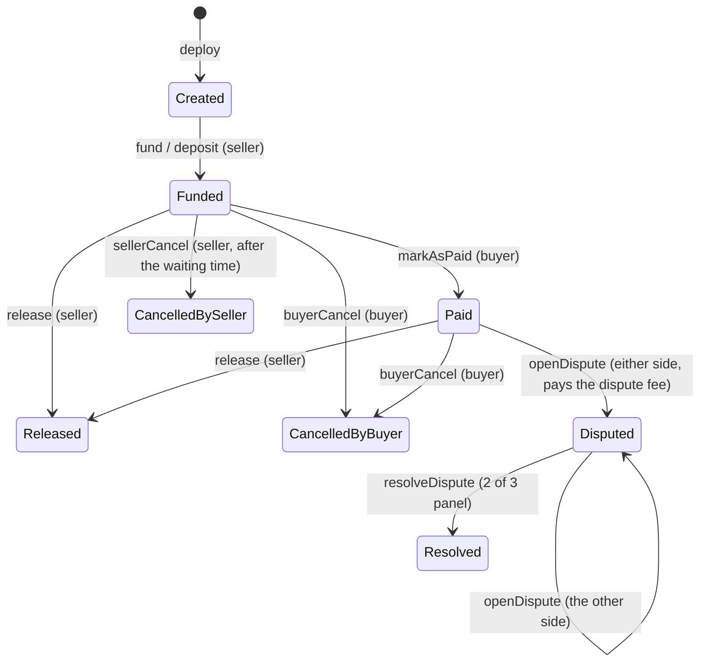

# Jamin

Peer-to-peer trade escrow for Bitcoin Cash, written in SolidCash.

A seller locks BCH (or a CashToken such as PUSD) in a contract. The buyer pays in fiat off chain (bank transfer, e-wallet)
and marks the trade as paid. The seller then releases the coins to the buyer. If the two disagree, either side can open a
dispute by posting a dispute fee, and two of three named arbitrators decide who receives the coins. Nobody holds the funds in the middle:
the contract only lets each role do what the trade rules allow, checked by signature.

Jamin is an entry for **BCH BLAZE 2026**, bounty **Best SolidCash Application**. It is a port of the MIT-licensed
`OpenPeerEscrow.sol` contract from EVM to the Bitcoin Cash UTXO model (see `NOTICE`).

## For judges: one minute

- **Try it:** https://jamin.sasateguh.com, tab **Try it**. The compiled contracts run on the SolidCash mock network
  in your browser. Play seller, buyer, arbitrator (panel member A, signing with member B or alone, which the contract refuses) or an outsider through all five branches and see each transaction
  or the contract's named error. The seller can also trade through a demo wallet in the page that answers the BCH
  WalletConnect requests and signs the seller's coins (decision 0009). English and Bahasa Melayu.
- **Contracts:** `contracts/` (four files, native SolidCash): `EscrowBase.scash`, `JaminEscrow.scash` (BCH),
  `JaminTokenEscrow.scash` (CashTokens such as PUSD), `FeeMath.scash`. Rules: `docs/SPEC.md`.
- **Tests:** `npm ci && npm run solidhat:test`: 92 SolidHat tests in 10 files on the mock network with the production
  profile (count in `docs/MEASURED.md`). Every attack in `docs/THREAT_MODEL.md` names the test that runs it.
- **Real consensus limits:** all five branches ran on a stock Bitcoin Cash Node 29.0.0 regtest node with
  standardness rules on, the dispute decided by two of the three panel members: 20 transactions mined, largest
  unlocking script 6,888 of 10,000 bytes (`docs/MEASURED.md`, "Regtest").
- **Trading from a wallet:** a seller whose wallet signs over the BCH WalletConnect methods created, funded and
  released an escrow on the same regtest node, every seller input signed by the wallet (branch W, 4 transactions,
  `docs/MEASURED.md`, "Wallet signing"; `docs/decisions/0009-wallet-connection.md`).
- **Mainnet:** branches A, C, D and E, and branch W from a seller wallet, ran on Bitcoin Cash mainnet from the
  project's test wallet: 20 transactions, the dispute decided by two of the three panel members (`docs/MEASURED.md`,
  "Mainnet"; `examples/mainnet.json`; the Lifecycle tab links each txid to an explorer).
- **SolidCash features used:** 21, each with the test that exercises it, in `docs/FEATURES.md`.
- **Upstream:** three fixes found while building this are open as pull requests to SolidCash (#8, #9, #10;
  "Upstream contributions").
- **Slides:** https://jamin.sasateguh.com/deck.pdf, eight slides printed from `tools/deck/slides.json`
  (`npx tsx tools/deck/build.ts`); every number on them cites its section of `docs/MEASURED.md` or the findings.
- **Port:** every OpenPeerEscrow function, event and modifier and what became of it, in `docs/PORTING.md`.

## Who it is for

Two people who do not know each other want to trade BCH or a dollar token such as PUSD for local money (bank
transfer, e-wallet). Today one of them has to send first, or both have to trust an exchange that holds the coins.
With Jamin the seller's coins sit in a contract that pays out only along the trade rules: to the buyer when the
seller confirms the fiat arrived, back to the seller when the buyer cancels or never pays, and by the arbitration panel's
decision only when one side opens a dispute and pays the dispute fee.

## Lifecycle



1. **Deploy** with the seller, buyer, three arbitration panel keys and fee recipient as contract parameters and the amount, fee rate,
   dispute fee and waiting time as constructor arguments.
2. **`fund`** (BCH) or **`deposit`** (token): the seller pays exactly amount + fee into the contract.
3. **`markAsPaid`**: the buyer confirms the fiat payment. From here the seller can no longer cancel.
4. **`release`**: the seller sends the amount to the buyer and the fee (basis points of the amount) to the fee
   recipient.
5. **`buyerCancel`**: the buyer can cancel before release; amount and fee return to the seller.
6. **`sellerCancel`**: the seller can cancel only after the waiting time and only if the buyer has not marked paid.
7. **`openDispute`**: after the buyer marked paid, either side opens a dispute by paying the dispute fee.
8. **`resolveDispute`**: two of the three panel arbitrators sign (`checkMultiSig`) and pick the winner. The winner's dispute fee is returned; the loser's goes to the
   fee recipient.

Every payout is a covenant output: the contract fixes who receives what, so nobody building the transaction can
redirect it. Roles prove themselves with `checkSig` against the keys in the contract.

## SolidCash features

| Feature | Where |
| --- | --- |
| Native stateful contract, one instance per escrow | `contracts/EscrowBase.scash` |
| Abstract base contract, inheritance, imports, a library | `EscrowBase`, `JaminEscrow`, `JaminTokenEscrow`, `FeeMath` |
| `enum`, `struct`, `constant`, constructor arguments | `contracts/EscrowBase.scash` |
| Modifiers with parameters, stacked; `checkSig` roles | `onlySeller`, `onlyBuyer`, `onlyToken`, `whenOpen` |
| `checkMultiSig` 2-of-3 arbitration panel (ECDSA) | `onlyPanel` on `resolveDispute` |
| Named custom errors and events | 18 errors, 8 events in `EscrowBase` and `JaminTokenEscrow` |
| `payable` and `msg.value`; `pragma satoshicontainer single` | `fund`, `openDispute` |
| Satoshi and token container payouts as covenant outputs | `this.transfer`, `this.tokens[c].transfer` |
| Token deposit checked through `this.outState.tokens[c]` | `JaminTokenEscrow.deposit` |
| Absolute time lock `tx.time` | `sellerCancel` |
| SDK: `StatefulContract.deploy`, `connect`, `TransactionBuilder` | `src/lifecycle/` (regtest and mainnet runner) |
| SDK: `SignatureAlgorithm.ECDSA` signatures for `checkMultiSig` | panel signers in `src/lifecycle/context.ts` |
| SDK: `Signer.external`, a wallet paying and signing its own inputs | `src/lifecycle/wallet-branch.ts` (branch W) |
| SDK: `MockNetworkProvider` with the production profile | every SolidHat test |

The full table, with file and line and the test for each row, is `docs/FEATURES.md`; `tests/features-doc.test.ts`
keeps its references honest.

## Proof

| What | Where |
| --- | --- |
| SolidHat tests (92, mock network, production profile) | `test/`, count in `docs/MEASURED.md` |
| Sabotage: a check removed from a copy of a contract makes its named test fail | `docs/MEASURED.md` |
| Script and transaction sizes of every function | `docs/MEASURED.md` |
| Size and miner fee of each call on regtest | "Size and cost" below, `examples/regtest.json` |
| Five branches on stock BCHN 29.0.0 regtest, 20 txids | `docs/MEASURED.md`, `examples/regtest.json` |
| Web app end-to-end tests on Chromium and WebKit (iPhone 13), and on the public URL | `e2e/`, `docs/MEASURED.md` |
| Mainnet run: branches A, C, D, E and W, 20 txids | `docs/MEASURED.md` "Mainnet", `examples/mainnet.json` |

## Size and cost

Every call to an escrow carries the whole contract in one input, so the size of a call is set by the contract, not
by the trade. Redeem scripts: `JaminEscrow` 5,114 bytes, `JaminTokenEscrow` 6,518 bytes. The limit per input is
10,000 bytes of unlocking script. Each row is one transaction of the stock BCHN 29.0.0 regtest run (branch named,
txids in `examples/regtest.json`); the two "mock" rows come from the production-profile mock network, as the regtest
token branch does not open a dispute. Sources: `docs/MEASURED.md`, sections "Regtest (real consensus limits)" and
"Escrow contract sizes".

| Contract | Function | Branch | Largest unlocking script (B) | Transaction (B) | Miner fee, regtest (sat) | Miner fee, mainnet (sat) |
| --- | --- | --- | --- | --- | --- | --- |
| JaminEscrow | `createEscrow` | A | 100 | 758 | 1,758 | 1,758 |
| JaminEscrow | `fund` | A | 5,418 | 6,872 | 7,062 | 7,062 |
| JaminEscrow | `markAsPaid` | A | 5,418 | 6,168 | 6,358 | 6,358 |
| JaminEscrow | `release` | A | 5,418 | 7,225 | 7,415 | 7,415 |
| JaminEscrow | `buyerCancel` | C | 5,418 | 7,047 | 7,237 | 7,237 |
| JaminEscrow | `sellerCancel` | D | 5,418 | 7,047 | 7,237 | 7,237 |
| JaminEscrow | `openDispute` | E | 5,419 | 7,236 | 7,426 | 7,426 |
| JaminEscrow | `resolveDispute` | E | 5,499 | 7,666 | 7,855 | 7,855 |
| JaminTokenEscrow | `createEscrow` | B | 100 | 754 | 1,754 | not run on mainnet |
| JaminTokenEscrow | `deposit` | B | 6,888 | 8,420 | 8,610 | not run on mainnet |
| JaminTokenEscrow | `markAsPaid` | B | 6,888 | 7,638 | 7,828 | not run on mainnet |
| JaminTokenEscrow | `release` | B | 6,888 | 8,748 | 8,938 | not run on mainnet |
| JaminTokenEscrow | `openDispute` | mock | 6,856 | 8,671 | not run on regtest | not run on mainnet |
| JaminTokenEscrow | `resolveDispute` | mock | 6,967 | 9,840 | not run on regtest | not run on mainnet |

The token escrow's `buyerCancel` and `sellerCancel` have tests but no size measurement yet. A contract call pays
about 1.03 sat per byte. `createEscrow` pays 1,000 sats more than its size, a margin the SDK's
deployment adds when no fee is given. The mainnet column is the same call in the mainnet run (`examples/mainnet.json`):
the token escrow has not run on mainnet (see "Known limits").
Sizes vary by a few bytes between runs (signature length) and by the number of coins the caller's wallet adds.

## Upstream contributions

Building Jamin turned up ten issues in SolidCash 0.51.1, each recorded with a minimal reproduction in
`docs/SOLIDCASH-FINDINGS.md`. Three have a small fix with a regression test that fails on upstream `master` and
passes with the change, and each is open as a pull request:

- [solidcash/solidcash#8](https://github.com/solidcash/solidcash/pull/8): a constructor `require` that fails is
  reported as missing state writes (F8).
- [solidcash/solidcash#9](https://github.com/solidcash/solidcash/pull/9): a framed contract cannot pay to
  `new LockingBytecodeP2PKH(...)` (F1).
- [solidcash/solidcash#10](https://github.com/solidcash/solidcash/pull/10): `MockNetworkProvider` does not
  type-check under `exactOptionalPropertyTypes` (F4).

The reasons the other seven are not are in the same file.

## Known limits

- **Mainnet:** the BCH escrow ran on mainnet (branches A, C, D, E, W). The token escrow (branch B, PUSD) has run on
  regtest and the mock network only; the test wallet holds no PUSD.
- **Coins left behind:** a single satoshi container cannot be emptied by a call, so each escrow keeps the reserve
  it was opened with (1,000 sats). The contract's state lives in token container coins that stay on chain as well:
  on mainnet each escrow left about 11,356 sats in such coins on top of its miner fees (`docs/MEASURED.md`,
  "Mainnet"). A token escrow also keeps one base unit (0.01 PUSD) and its token container's
  satoshis.
- **No release or cancel during a dispute:** once a dispute is open only the arbitration panel settles it. The original
  OpenPeer escrow still allowed release and buyer cancel then.
- **Absolute waiting time:** the seller passes `cancelAfter` as a timestamp, because a SolidCash constructor cannot
  read the clock. A seller cancel becomes possible about an hour after it, as Bitcoin Cash compares against the
  median time of past blocks.
- **Error names from the SDK:** a seller cancel before the waiting time is reported as a locktime failure, not
  `TooEarly` (F7), and a failing constructor check is not reported by name (F8).
- **Dropped from the original:** meta transactions, the fee discount NFT and partner split, the proxy deployer and
  the seller balance pool (reasons in `docs/PORTING.md`).
- **Wallets:** a seller can trade from a wallet that signs over the BCH WalletConnect methods: the wallet pays and
  signs its own inputs, and the seller's escrow key is derived from a message the wallet signs
  (`docs/decisions/0009-wallet-connection.md`; a wallet cannot sign the contract's own signature check through the
  SDK, F10). This is tested on the mock network and on regtest with a protocol-level test wallet, and the simulator
  shows it with a demo wallet in the page. The web app does not open a WalletConnect session to a phone wallet,
  which needs a relay project id. Payments back to such a seller go to the escrow key's
  address.

## Development

Requires Node 22.

```sh
npm ci
npm run solidhat:test   # compile the contracts and run the SolidHat tests on the mock network
npm run gate            # lint, types, SolidHat tests, unit tests, build
```

Project values (network, Electrum server, token category, fees, waiting time, spending budget) live in `config/jamin.json`.
User interface text lives in `lang/en.json` and `lang/ms.json`. Decisions are recorded in `docs/decisions/`.

### Regtest run

Runs the five lifecycle branches (BCH release, token release, buyer cancel, seller cancel after the waiting time,
dispute and resolution) on a throwaway Bitcoin Cash Node in Docker with stock limits. Needs Docker and `jq`.

```sh
bash scripts/regtest-node.sh start
npm run lifecycle -- --network regtest
bash scripts/regtest-node.sh stop
npx tsx scripts/regtest-example.ts state/regtest/run-<time>.json   # refresh examples/regtest.json
```

### Web app

The app in `web/` (Vite, React) has four tabs: a home page, **Try it** (the compiled contracts running on the
SolidCash mock network inside the browser, where you act as seller, buyer, arbitrator or someone else and see each
transaction or the contract's named error), **Lifecycle** (the state machine and every recorded run from
`examples/`), and **Contract** (the sources with the feature table of `docs/FEATURES.md`).

```sh
npm run build        # compile the contracts, then build the static site into dist/
npm run e2e          # Playwright: Chromium desktop and WebKit iPhone 13 against vite preview
```

The public site is one static container (nginx, read-only, no keys) built from a clean `git archive` of HEAD.
`deploy/deploy.sh` builds and starts it, then checks `/healthz` and runs the Playwright suite against the public URL,
rolling back to the previous image if that fails (`--rollback`, `--status`). See `docs/decisions/0006-deployment.md`.

### Test wallet

The lifecycle scripts use a test wallet of their own. Every role (seller, buyer, the three panel arbitrators, fee recipient) is a different
HD path of the same phrase, so funds stay inside the test wallet.

```sh
npm run wallet -- init      # create .env with a new phrase (mode 0600); refuses if .env already has one
npm run wallet -- address   # print the receive address and its balance
```

The scripts never print the phrase or any private key. Every mainnet broadcast goes through a spending budget
(`mainnet.budgetSats` in `config/jamin.json`) and refuses before broadcasting when the budget would be exceeded.

## AI disclosure

The code and documents in this repository were written by an AI coding agent. The project owner chose the problem, set the
rules the agent works under and reviews the result.

## License

MIT, see `LICENSE`. Third-party attribution is in `NOTICE`.
