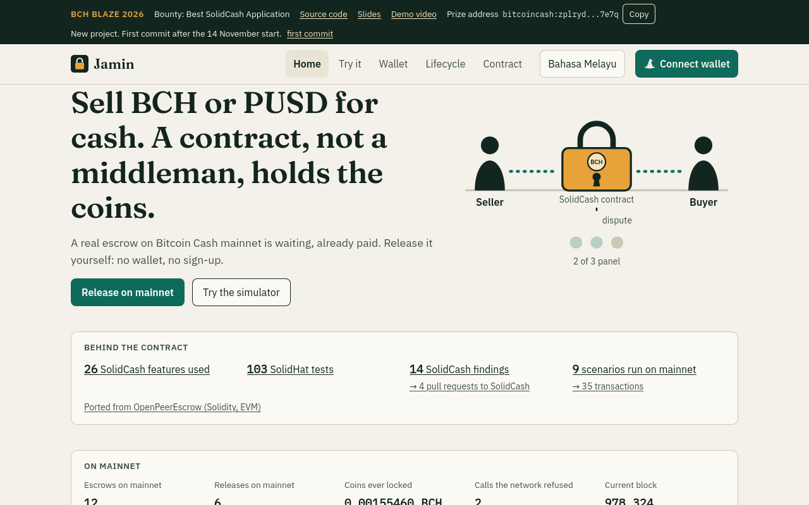
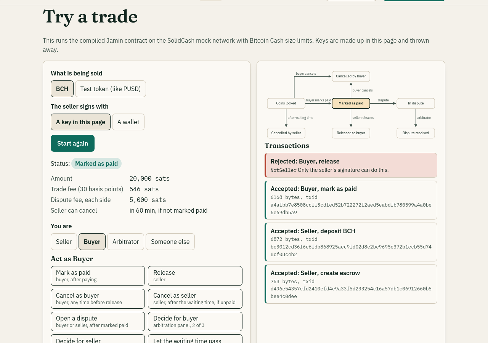
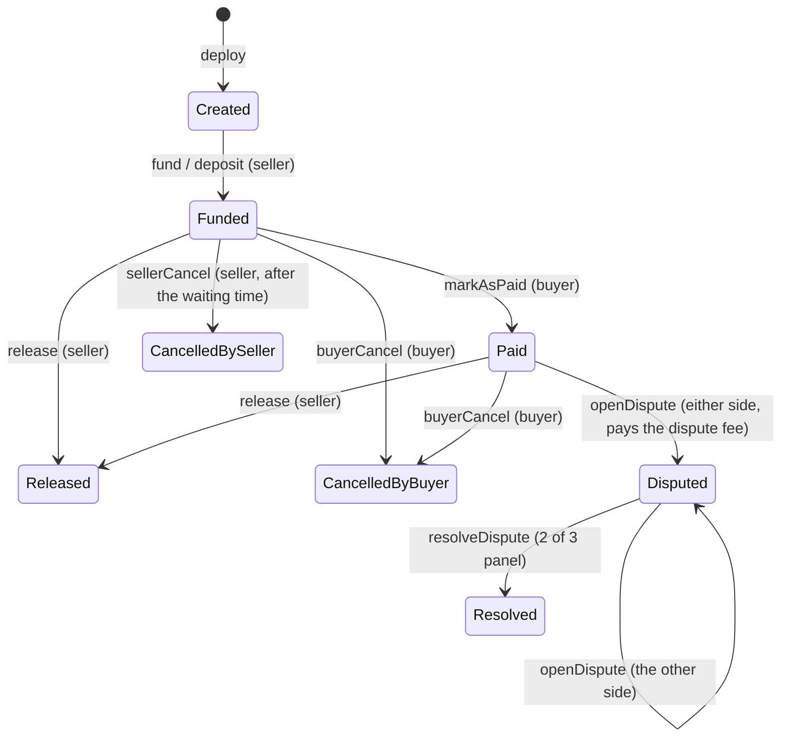

# <p align="center"><br>Jamin</p>

##### <p align="center"><a href="LICENSE"></a> <a href="https://jamin.sasateguh.com"></a> <a href="docs/MEASURED.md"></a> <a href="https://github.com/solidcash/solidcash"></a><br><br><i>Jual BCH atau PUSD untuk wang tunai. Kontrak, bukan orang tengah, yang memegang syiling.</i><br><a href="https://jamin.sasateguh.com"><b>live demo</b></a> · <a href="#for-judges-one-minute"><b>Judging? Start here</b></a> · <a href="#try-it">Try it</a> · <a href="#run-it-locally">Run it</a> · <a href="#proof">Tests and proof</a> · <a href="#known-limits">Limits</a> · <a href="docs/README.ms.md">Bahasa Melayu</a><br>Built in Malaysia by <a href="https://aimanmalib.com">Aiman Malib</a> · <a href="https://sasateguh.com">Sasa Teguh</a></p>

Sell BCH or PUSD for cash. A contract, not a middleman, holds the coins.

Press **Release on mainnet** at https://jamin.sasateguh.com to release a waiting demo escrow on Bitcoin Cash mainnet, signed in your browser, or **Try the simulator** to play every branch on the SolidCash mock network.

On mainnet so far: 12 escrows, 0.00155460 BCH and 0.23 PUSD locked in them, and 2 calls refused by the network.
Counted from `examples/mainnet.json`, the same numbers as the strip on the home page.



Jamin is peer-to-peer trade escrow for Bitcoin Cash, written in SolidCash. A seller locks BCH (or a CashToken such as PUSD) in a contract. The buyer pays in fiat off chain (bank transfer, e-wallet)
and marks the trade as paid. The seller then releases the coins to the buyer. If the two disagree, either side can open a
dispute by posting a dispute fee, and two of three named arbitrators decide who receives the coins. Nobody holds the funds in the middle:
the contract only lets each role do what the trade rules allow, checked by signature.

Jamin is an entry for **BCH BLAZE 2026**, bounty **Best SolidCash Application**. It is a port of the MIT-licensed
`OpenPeerEscrow.sol` contract from EVM to the Bitcoin Cash UTXO model (see `NOTICE`).
Prize and EMBER2026 vote address of this entry: `bitcoincash:zrj2rs2l79uyjvhq2slcxuhfplp29cc3as2kg5u2qv`.

New project. First commit after the 14 November start:
[first commit](https://github.com/aimanmalib/jamin/commit/4ad48710f055ef59b318338b0020f817be1dc277).

## For judges: one minute

- **Demo video (55 seconds, no sound):** https://jamin.sasateguh.com/media/jamin-demo.mp4?v=1fa77a38, also on the
  home page of the site.
- **Try it:** https://jamin.sasateguh.com, tab **Try it**. The compiled contracts run on the SolidCash mock network
  in your browser. Play seller, buyer, arbitrator (panel member A, signing with member B or alone, which the contract refuses) or an outsider through all five branches and see each transaction
  or the contract's named error. The seller can also trade through a demo wallet in the page that answers the BCH
  WalletConnect requests and signs the seller's coins (decision 0009). English and Bahasa Melayu.
- **Contracts:** `contracts/` (four files, native SolidCash): `EscrowBase.scash`, `JaminEscrow.scash` (BCH),
  `JaminTokenEscrow.scash` (CashTokens such as PUSD), `FeeMath.scash`. Rules: `docs/SPEC.md`.
- **Tests:** `npm ci && npm run solidhat:test`: 103 SolidHat tests in 12 files on the mock network with the production
  profile (count in `docs/MEASURED.md`). Every attack in `docs/THREAT_MODEL.md` names the test that runs it.
- **Real consensus limits:** all five branches ran on a stock Bitcoin Cash Node 29.0.0 regtest node with
  standardness rules on, the dispute decided by two of the three panel members: 20 transactions mined, largest
  unlocking script 6,888 of 10,000 bytes (`docs/MEASURED.md`, "Regtest").
- **Trading from a wallet:** a seller whose wallet signs over the BCH WalletConnect methods created, funded and
  released an escrow on the same regtest node, every seller input signed by the wallet (branch W, 4 transactions,
  `docs/MEASURED.md`, "Wallet signing"; `docs/decisions/0009-wallet-connection.md`).
- **Mainnet:** branches A, C, D and E, branch W from a seller wallet, and branch B with 0.10 PUSD bought from a
  Cauldron pool, ran on Bitcoin Cash mainnet from the project's test wallet: 24 escrow transactions, the dispute
  decided by two of the three panel members (`docs/MEASURED.md`, "Mainnet"; `examples/mainnet.json`; the Lifecycle
  tab links each txid to an explorer).
- **A third-party wallet on mainnet:** on the site's **Wallet** tab a seller connects a wallet over WizardConnect
  and sells BCH through a real escrow. Cashonize v0.15.2, built from its tag and driven by a script with a phrase of
  its own, signed the seller key request, the creation, the deposit and the release of one mainnet escrow there
  (branch X, 4 escrow transactions, `docs/MEASURED.md`, "Third-party wallet on mainnet";
  `docs/decisions/0014-third-party-wallet.md`).
- **Refused by the network:** in branch R on mainnet, a seller cancel sent before its time and a release signed by
  the buyer were sent as raw transactions past the SDK's own checks, and the network refused both; the server's text
  is recorded verbatim, the escrow's coins stayed unspent, and the seller's valid release followed (4 more escrow
  transactions; `docs/MEASURED.md`, "Refused on mainnet").
- **Relayed token cancel on mainnet:** in branch T the buyer signed `buyerCancel` on a PUSD escrow and wrote it to two
  files; the keyless relayer checked the transaction against the buyer's intent and broadcast it, and the 10 units
  went back to the seller (3 escrow transactions; `docs/MEASURED.md`, "Relayed token cancel on mainnet").
- **SolidCash features used:** 26, each with the test that exercises it, in `docs/FEATURES.md`.
- **Upstream:** four fixes found while building this are open as pull requests to SolidCash (#8, #9, #10, #15;
  "Upstream contributions").
- **Slides:** https://jamin.sasateguh.com/deck.pdf, eight slides printed from `tools/deck/slides.json`
  (`npx tsx tools/deck/build.ts`); every number on them cites its section of `docs/MEASURED.md` or the findings.
- **Port:** every OpenPeerEscrow function, event and modifier and what became of it, in `docs/PORTING.md`.

## Try it

1. Open https://jamin.sasateguh.com and press **Release on mainnet**. A demo escrow that is already funded and marked
   paid on Bitcoin Cash mainnet is released in your browser, with no wallet and no sign-up, and the page links the
   transaction. While no demo escrow is waiting, the card says when the next one should be ready.
2. Press **Try the simulator** (the **Try it** tab), then **Start a trade**. The compiled contracts run on the
   SolidCash mock network inside the page. Pick a role (seller, buyer, arbitrator or someone else) and press its
   actions: each one shows the transaction it built, or the contract's named error when the role may not do it.
3. The **Lifecycle** tab lists every escrow run outside the simulator, on regtest and on mainnet, with its
   transactions; mainnet ones link to an explorer. The **Contract** tab shows the sources with the feature table.



## Who it is for

Two people who do not know each other want to trade BCH or a dollar token such as PUSD for local money (bank
transfer, e-wallet). Today one of them has to send first, or both have to trust an exchange that holds the coins.
With Jamin the seller's coins sit in a contract that pays out only along the trade rules: to the buyer when the
seller confirms the fiat arrived, back to the seller when the buyer cancels or never pays, and by the arbitration panel's
decision only when one side opens a dispute and pays the dispute fee.

## Lifecycle



1. **Deploy** with the seller, buyer, three arbitration panel keys and fee recipient as contract parameters and the amount, fee rate,
   dispute fee and waiting time as constructor arguments.
2. **`fund`** (BCH) or **`deposit`** (token): the seller pays exactly amount + fee into the contract.
3. **`markAsPaid`**: the buyer confirms the fiat payment. From here the seller can no longer cancel.
4. **`release`**: the seller sends the amount to the buyer and the fee (basis points of the amount) to the fee
   recipient.
5. **`buyerCancel`**: the buyer can cancel before release; amount and fee return to the seller.
6. **`sellerCancel`**: the seller can cancel only after the waiting time and only if the buyer has not marked paid.
7. **`openDispute`**: after the buyer marked paid, either side opens a dispute by paying the dispute fee.
8. **`resolveDispute`**: two of the three panel arbitrators sign (`checkMultiSig`) and pick the winner. The winner's dispute fee is returned; the loser's goes to the
   fee recipient.

Every payout is a covenant output: the contract fixes who receives what, so nobody building the transaction can
redirect it. Roles prove themselves with `checkSig` against the keys in the contract.

## SolidCash features

| Feature | Where |
| --- | --- |
| Native stateful contract, one instance per escrow | `contracts/EscrowBase.scash` |
| Abstract base contract, inheritance, imports, a library | `EscrowBase`, `JaminEscrow`, `JaminTokenEscrow`, `FeeMath` |
| `enum`, `struct`, `constant`, constructor arguments | `contracts/EscrowBase.scash` |
| Modifiers with parameters, stacked; `checkSig` roles | `onlySeller`, `onlyBuyer`, `onlyToken`, `whenOpen` |
| `checkMultiSig` 2-of-3 arbitration panel (ECDSA) | `onlyPanel` on `resolveDispute` |
| Named custom errors and events | 18 errors, 8 events in `EscrowBase` and `JaminTokenEscrow` |
| `payable` and `msg.value`; `pragma satoshicontainer single` | `fund`, `openDispute` |
| Satoshi and token container payouts as covenant outputs | `this.transfer`, `this.tokens[c].transfer` |
| Token deposit checked through `this.outState.tokens[c]` | `JaminTokenEscrow.deposit` |
| Absolute time lock `tx.time` | `sellerCancel` |
| SDK: `StatefulContract.deploy`, `connect`, `TransactionBuilder` | `src/lifecycle/` (regtest and mainnet runner) |
| SDK: `SignatureAlgorithm.ECDSA` signatures for `checkMultiSig` | panel signers in `src/lifecycle/context.ts` |
| SDK: `Signer.external`, a wallet paying and signing its own inputs | `src/lifecycle/wallet-branch.ts` (branch W) |
| SDK: `MockNetworkProvider` with the production profile | every SolidHat test |

The full table, with file and line and the test for each row, is `docs/FEATURES.md`; `tests/features-doc.test.ts`
keeps its references honest.

## Proof

| What | Where |
| --- | --- |
| SolidHat tests (103, mock network, production profile) | `test/`, count in `docs/MEASURED.md` |
| Sabotage: a check removed from a copy of a contract makes its named test fail | `docs/MEASURED.md` |
| Script and transaction sizes of every function | `docs/MEASURED.md` |
| Size and miner fee of each call on regtest | "Size and cost" below, `examples/regtest.json` |
| Five branches on stock BCHN 29.0.0 regtest, 20 txids | `docs/MEASURED.md`, `examples/regtest.json` |
| Web app end-to-end tests on Chromium and WebKit (iPhone 13), and on the public URL | `e2e/`, `docs/MEASURED.md` |
| Mainnet run: branches A to E and W, 24 escrow txids, PUSD bought from a Cauldron pool | `docs/MEASURED.md` "Mainnet", `examples/mainnet.json` |
| Mainnet branch X: Cashonize signs the seller's steps on the Wallet tab over WizardConnect | `docs/MEASURED.md` "Third-party wallet on mainnet", `examples/mainnet.json` |
| Mainnet branch R: two forbidden calls the network refused (server text, raw hashes), then a valid release | `docs/MEASURED.md` "Refused on mainnet", `examples/mainnet.json` |
| Mainnet branch T: a token escrow's `buyerCancel` broadcast by the keyless relayer | `docs/MEASURED.md` "Relayed token cancel on mainnet", `examples/mainnet.json` |
| Mainnet branch P: three public demo escrows created, funded and marked paid, left for visitors to release from the home page | `docs/MEASURED.md` "Demo escrow" and "Demo pool on mainnet", `examples/mainnet.json` |

## Size and cost

Every call to an escrow carries the whole contract in one input, so the size of a call is set by the contract, not
by the trade. Redeem scripts: `JaminEscrow` 5,114 bytes, `JaminTokenEscrow` 6,518 bytes. The limit per input is
10,000 bytes of unlocking script. Each row is one transaction of the stock BCHN 29.0.0 regtest run (branch named,
txids in `examples/regtest.json`); the two "mock" rows come from the production-profile mock network, as the regtest
token branch does not open a dispute. Sources: `docs/MEASURED.md`, sections "Regtest (real consensus limits)" and
"Escrow contract sizes".

| Contract | Function | Branch | Largest unlocking script (B) | Transaction (B) | Miner fee, regtest (sat) | Miner fee, mainnet (sat) |
| --- | --- | --- | --- | --- | --- | --- |
| JaminEscrow | `createEscrow` | A | 100 | 758 | 1,758 | 1,758 |
| JaminEscrow | `fund` | A | 5,418 | 6,872 | 7,062 | 7,062 |
| JaminEscrow | `markAsPaid` | A | 5,418 | 6,168 | 6,358 | 6,358 |
| JaminEscrow | `release` | A | 5,418 | 7,225 | 7,415 | 7,415 |
| JaminEscrow | `buyerCancel` | C | 5,418 | 7,047 | 7,237 | 7,237 |
| JaminEscrow | `sellerCancel` | D | 5,418 | 7,047 | 7,237 | 7,237 |
| JaminEscrow | `openDispute` | E | 5,419 | 7,236 | 7,426 | 7,426 |
| JaminEscrow | `resolveDispute` | E | 5,499 | 7,666 | 7,855 | 7,855 |
| JaminTokenEscrow | `createEscrow` | B | 100 | 754 | 1,754 | 1,750 |
| JaminTokenEscrow | `deposit` | B | 6,888 | 8,420 | 8,610 | 8,606 |
| JaminTokenEscrow | `markAsPaid` | B | 6,888 | 7,638 | 7,828 | 7,828 |
| JaminTokenEscrow | `release` | B | 6,888 | 8,748 | 8,938 | 8,934 |
| JaminTokenEscrow | `openDispute` | mock | 6,856 | 8,671 | not run on regtest | not run on mainnet |
| JaminTokenEscrow | `resolveDispute` | mock | 6,967 | 9,840 | not run on regtest | not run on mainnet |

The token escrow's `buyerCancel` and `sellerCancel` have tests but no size measurement yet. A contract call pays
about 1.03 sat per byte. `createEscrow` pays 1,000 sats more than its size, a margin the SDK's
deployment adds when no fee is given. The mainnet column is the same call in the mainnet run (`examples/mainnet.json`);
the token escrow's dispute calls have not run on mainnet.
Sizes vary by a few bytes between runs (signature length) and by the number of coins the caller's wallet adds.

## Upstream contributions

Building Jamin turned up fourteen issues in SolidCash 0.51.1, each recorded with a minimal reproduction in
`docs/SOLIDCASH-FINDINGS.md`. Four have a small fix with a regression test that fails on upstream `master` and
passes with the change, and each is open as a pull request:

- [solidcash/solidcash#8](https://github.com/solidcash/solidcash/pull/8): a constructor `require` that fails is
  reported as missing state writes (F8).
- [solidcash/solidcash#9](https://github.com/solidcash/solidcash/pull/9): a framed contract cannot pay to
  `new LockingBytecodeP2PKH(...)` (F1).
- [solidcash/solidcash#10](https://github.com/solidcash/solidcash/pull/10): `MockNetworkProvider` does not
  type-check under `exactOptionalPropertyTypes` (F4).
- [solidcash/solidcash#15](https://github.com/solidcash/solidcash/pull/15): the SDK leaves filler outputs that anyone
  may sweep but exports no way to spend one (F14).

F12 (the destroy helper spends event records whose lock has not passed) is addressed by open upstream pull request
[solidcash/solidcash#13](https://github.com/solidcash/solidcash/pull/13), so no duplicate was opened. The reasons the
other nine are not are in the same file.

## Known limits

- **Mainnet:** the BCH escrow ran on mainnet (branches A, C, D, E, W, R); the token escrow ran branch B (release) with
  0.10 PUSD, a smaller amount than the 2.00 of the regtest run, as 0.01 PUSD costs about 4,800 sats (decision 0012).
  The token escrow's buyer cancel ran on mainnet through the relayer (branch T, 0.09 PUSD); its seller cancel and
  dispute paths ran on regtest or the mock network only.
- **Coins left behind:** no entry point of these contracts spends a finished escrow's coins: each one checks a status
  the escrow has left (`docs/MEASURED.md`, "Final state", tried for all seven mainnet escrows). After the claims below,
  the seven escrows held 75,976 sats in contract coins. 41,800 of them (the master and state NFTs, the 1,000-sat
  reserve, and B's token container with 1 unit, 0.01 PUSD) cannot be spent. 33,600 were event records, which anyone
  may sweep 144 blocks after they were mined, and 576 sats an SDK filler output (F14), which anyone may also sweep
  after 144 blocks; the wallet swept all 34,176 back on mainnet in seven transactions (`docs/MEASURED.md`). Each
  escrow's metadata identity (756 sats) was burned by its owner, which returned 78 sats net after the fee. Every
  satoshi of the test wallet is accounted for, with 0 unexplained.
- **Public demo keys:** the "Release on mainnet" card signs with keys published in `config/demo.json` on purpose.
  Anyone may use them; each demo escrow puts at most `maxSats` (24,000 sats) in their reach, and they are not derived
  from any wallet (`docs/decisions/0020-public-demo-escrow.md`). Each demo escrow (branch P in
  `examples/mainnet.json`) was created, funded and marked paid on mainnet by the test wallet; one press releases it
  for good, and the card moves on to the next one still waiting. A host cron keeps three such escrows waiting within a pool
  budget of 400,000 sats net of what it sweeps back (`docs/decisions/0021-demo-escrow-pool.md`): three wait now, and
  it stages again after a release until that budget or `restageUntil` in `config/demo.json` runs out. A release
  costs the pool about 36,600 sats net on regtest, so the budget covers about eight more after the first three
  (`docs/MEASURED.md` "Demo pool"). While none waits, the card says when the next one should be ready; once the
  pool is closed, it says so and shows the last release.
- **No close function:** a `close` that ends a finished escrow with `selfdestruct(seller)` was built and measured,
  and left out (`docs/decisions/0013-closing-an-escrow.md`). Its covenant caps the miner fee below 2,000 sats, but
  the closing transaction is about 7,000 bytes, under the relay minimum of 1 sat per byte; and at that size a close
  would cost more than the about 5,800 sats it returns (SolidCash findings F11 to F13). New escrows therefore also
  keep their master, state and container coins.
- **Contract frozen at the mainnet build:** a refund anyone may trigger for an escrow the buyer never marked as paid,
  and a payment reference the buyer signs for `checkDataSig`, were considered and not added, so that the contracts
  stay the builds every mainnet escrow ran (`docs/decisions/0018-contract-frozen-at-the-mainnet-build.md`). The
  refund would have added 249 bytes to every BCH escrow call and 429 to every token escrow call; a seller who stays
  offline leaves an unpaid escrow locked until they sign a `sellerCancel`.
- **No release or cancel during a dispute:** once a dispute is open only the arbitration panel settles it. The original
  OpenPeer escrow still allowed release and buyer cancel then.
- **Absolute waiting time:** the seller passes `cancelAfter` as a timestamp, because a SolidCash constructor cannot
  read the clock. A seller cancel becomes possible about an hour after it, as Bitcoin Cash compares against the
  median time of past blocks.
- **Error names from the SDK:** a seller cancel before the waiting time is reported as a locktime failure, not
  `TooEarly` (F7), and a failing constructor check is not reported by name (F8).
- **Relayer:** the keyless relayer broadcast one token escrow `buyerCancel` on mainnet and one on regtest, each from
  the files the buyer wrote (branch T, `docs/MEASURED.md`). A relayer can still decline to send or send late (the
  party can send the same transaction itself).
- **Dropped from the original:** meta transactions, the fee discount NFT and partner split, the proxy deployer and
  the seller balance pool (reasons in `docs/PORTING.md`).
- **Wallets:** a seller can trade from a wallet that signs over the BCH WalletConnect methods: the wallet pays and
  signs its own inputs, and the seller's escrow key is derived from a message the wallet signs
  (`docs/decisions/0009-wallet-connection.md`; a wallet cannot sign the contract's own signature check through the
  SDK, F10). This is tested on the mock network and on regtest with a protocol-level test wallet, and the simulator
  shows it with a demo wallet in the page. The Wallet tab connects a real wallet over WizardConnect, which needs no
  relay account (decision 0014); the BCH WalletConnect protocol needs a relay project id and is not connected.
  On mainnet the third-party wallet was Cashonize driven by a script, so it shows that a wallet nobody here wrote
  signs these transactions, not a person's judgement; no phone wallet has been tried. The tab needs a wallet coin
  at output 0 for the escrow's token genesis, and sells only BCH, at an amount the site fixes, with disputes going
  to the site's demo panel. Payments back to such a seller go to the escrow key's address.

## Run it locally

Requires Node 22.

```sh
npm ci
npm run solidhat:test   # compile the contracts and run the SolidHat tests on the mock network
npm run gate            # lint, types, SolidHat tests, unit tests, build
```

Project values (network, Electrum server, token category, fees, waiting time, spending budget) live in `config/jamin.json`.
User interface text lives in `lang/en.json` and `lang/ms.json`. Decisions are recorded in `docs/decisions/`.

### Regtest run

Runs the five lifecycle branches (BCH release, token release, buyer cancel, seller cancel after the waiting time,
dispute and resolution) on a throwaway Bitcoin Cash Node in Docker with stock limits. Needs Docker and `jq`.

```sh
bash scripts/regtest-node.sh start
npm run lifecycle -- --network regtest
bash scripts/regtest-node.sh stop
npx tsx scripts/regtest-example.ts state/regtest/run-<time>.json   # refresh examples/regtest.json
```

### Web app

The app in `web/` (Vite, React) has four tabs: a home page, **Try it** (the compiled contracts running on the
SolidCash mock network inside the browser, where you act as seller, buyer, arbitrator or someone else and see each
transaction or the contract's named error), **Lifecycle** (the state machine and every recorded run from
`examples/`), and **Contract** (the sources with the feature table of `docs/FEATURES.md`).

```sh
npm run build        # compile the contracts, then build the static site into dist/
npm run e2e          # Playwright: Chromium desktop and WebKit iPhone 13 against vite preview
```

The public site is one static container (nginx, read-only, no keys) built from a clean `git archive` of HEAD.
`deploy/deploy.sh` builds and starts it, then checks `/healthz` and runs the Playwright suite against the public URL,
rolling back to the previous image if that fails (`--rollback`, `--status`). See `docs/decisions/0006-deployment.md`.

### Relaying a signed call

A party that signs an escrow call but cannot broadcast it can hand the signed transaction and an intent (the escrow
coin it spends and every output it pays) to anyone. `src/relay/relay.ts` holds no key: it sends the bytes unchanged
only when they match the intent, and refuses a send that reports another txid. A relayer that changes an output and
the intent with it is refused by the network, because the party's signature and the covenant cover every output
(`test/relay.test.ts`; `docs/decisions/0019-keyless-relayer.md`).

```sh
npx tsx scripts/relay.ts tx.hex intent.json          # check only
npx tsx scripts/relay.ts tx.hex intent.json --send   # broadcast through the spending budget
npx tsx scripts/lifecycle.ts --network regtest --branches T --relay buyerCancel   # branch T on a regtest node
```

### Test wallet

The lifecycle scripts use a test wallet of their own. Every role (seller, buyer, the three panel arbitrators, fee recipient) is a different
HD path of the same phrase, so funds stay inside the test wallet.

```sh
npm run wallet -- init      # create .env with a new phrase (mode 0600); refuses if .env already has one
npm run wallet -- address   # print the receive address and its balance
npx tsx scripts/buy-token.ts          # quote the PUSD branch B needs from Cauldron pools; --send buys it
```

The scripts never print the phrase or any private key. Every mainnet broadcast goes through a spending budget
(`mainnet.budgetSats` in `config/jamin.json`) and refuses before broadcasting when the budget would be exceeded.

## AI disclosure

The code and documents in this repository were written by an AI coding agent. The project owner chose the problem, set the
rules the agent works under and reviews the result.

## License

MIT, see `LICENSE`. Third-party attribution is in `NOTICE`.

## Work with Sasa Teguh

I built this project. I run [Sasa Teguh](https://sasateguh.com), a studio in Malaysia that builds websites found on Google and in AI answers, and sets up systems like this one for businesses.

[Book a call](https://sasateguh.com/book) · hello@sasateguh.com · [More from Sasa Teguh](https://github.com/sasateguh)
