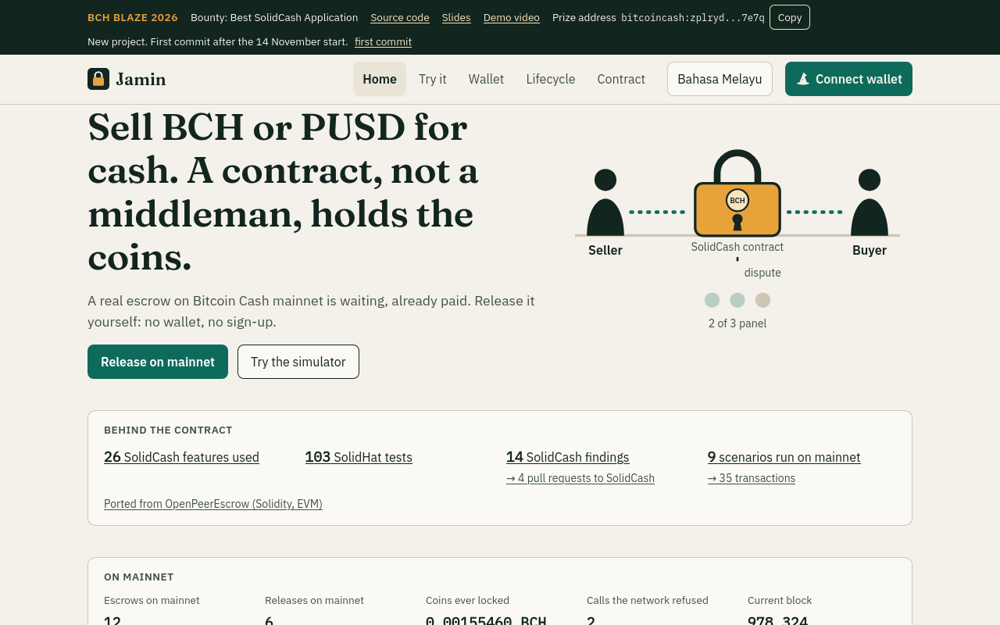
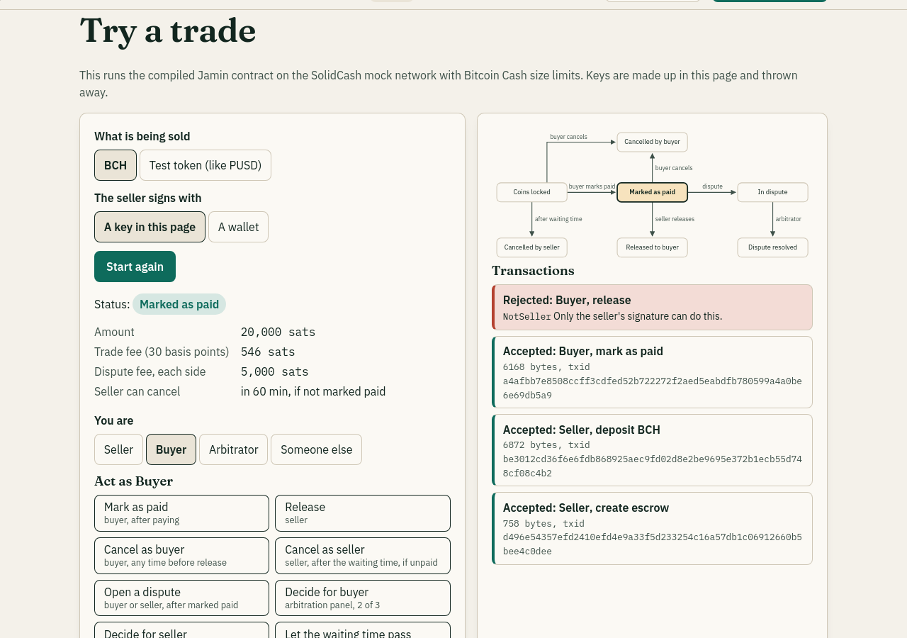

#  Jamin

Jual BCH atau PUSD untuk wang tunai. Kontrak, bukan orang tengah, yang memegang syiling.

<p><a href="LICENSE"></a> <a href="https://jamin.sasateguh.com"></a> <a href="docs/MEASURED.md"></a> <a href="https://github.com/solidcash/solidcash"></a></p>

<p><i>Sell BCH or PUSD for cash. A contract, not a middleman, holds the coins.</i><br>
<a href="https://jamin.sasateguh.com"><b>demo hidup</b></a> · <a href="#cuba">Cuba</a> · <a href="#jalankan-sendiri">Jalankan</a> · <a href="#ujian-dan-bukti">Ujian dan bukti</a> · <a href="#had">Had</a> · <a href="README.md">English</a><br>
Dibina di Malaysia oleh <a href="https://aimanmalib.com">Aiman Malib</a> · <a href="https://sasateguh.com">Sasa Teguh</a></p>

Ini ringkasan Bahasa Melayu bagi [README.md](README.md). Jadual penuh, angka ukuran dan setiap txid ada dalam versi
Inggeris dan `docs/MEASURED.md`; jika kedua-duanya berbeza, versi Inggeris yang terpakai.

Jamin ialah escrow dagangan rakan ke rakan untuk Bitcoin Cash, ditulis dalam SolidCash. Penjual mengunci BCH (atau
CashToken seperti PUSD) dalam kontrak. Pembeli membayar wang fiat di luar rantaian (pindahan bank, e-dompet) dan menanda
dagangan sebagai sudah dibayar. Penjual kemudian melepaskan syiling kepada pembeli. Jika kedua-duanya tidak bersetuju,
mana-mana pihak boleh membuka pertikaian dengan membayar yuran pertikaian, dan dua daripada tiga penimbang tara yang
dinamakan memutuskan siapa menerima syiling. Tiada sesiapa memegang dana di tengah: kontrak hanya membenarkan setiap
peranan melakukan apa yang peraturan dagangan benarkan, disemak dengan tandatangan.

Jamin ialah entri **BCH BLAZE 2026**, ganjaran **Best SolidCash Application**, iaitu port kontrak `OpenPeerEscrow.sol`
(lesen MIT) dari EVM ke model UTXO Bitcoin Cash (lihat `NOTICE`). Projek baharu: komit pertama selepas 14 November,
[komit pertama](https://github.com/aimanmalib/jamin/commit/4ad48710f055ef59b318338b0020f817be1dc277).



## Cuba

1. Buka https://jamin.sasateguh.com dan tekan **Release on mainnet**. Escrow demo yang sudah dibiayai dan ditanda
   dibayar di mainnet Bitcoin Cash dilepaskan dalam pelayar anda, tanpa dompet dan tanpa daftar, dan halaman memaut
   transaksinya. Bila tiada escrow demo menunggu, kad itu memberitahu bila yang seterusnya patut sedia.
2. Tekan **Try the simulator** (tab **Try it**), kemudian **Start a trade**. Kontrak yang dikompil berjalan di rangkaian
   olok-olok SolidCash dalam halaman. Pilih peranan (penjual, pembeli, penimbang tara atau orang lain) dan tekan
   tindakannya: setiap satu menunjukkan transaksi yang dibina, atau ralat bernama kontrak bila peranan itu tidak dibenarkan.
3. Tab **Lifecycle** menyenaraikan setiap escrow yang dijalankan di luar simulator, di regtest dan di mainnet, bersama
   transaksinya. Tab **Contract** menunjukkan kod sumber bersama jadual ciri. Laman ini dalam bahasa Inggeris dan Melayu.



Video demo (tanpa bunyi): https://jamin.sasateguh.com/media/jamin-demo.mp4 · slaid: https://jamin.sasateguh.com/deck.pdf

## Kitaran hayat

1. **Deploy** dengan kunci penjual, pembeli, tiga penimbang tara dan penerima yuran.
2. **`fund`** (BCH) atau **`deposit`** (token): penjual membayar tepat jumlah + yuran ke dalam kontrak.
3. **`markAsPaid`**: pembeli mengesahkan bayaran fiat. Selepas ini penjual tidak lagi boleh membatalkan.
4. **`release`**: penjual menghantar jumlah kepada pembeli dan yuran kepada penerima yuran.
5. **`buyerCancel`**: pembeli boleh membatalkan sebelum pelepasan; jumlah dan yuran kembali kepada penjual.
6. **`sellerCancel`**: penjual boleh membatalkan hanya selepas masa menunggu dan hanya jika pembeli belum menanda dibayar.
7. **`openDispute`**: selepas pembeli menanda dibayar, mana-mana pihak membuka pertikaian dengan membayar yuran pertikaian.
8. **`resolveDispute`**: dua daripada tiga penimbang tara menandatangani (`checkMultiSig`) dan memilih pemenang.

Setiap bayaran keluar ialah output covenant: kontrak menetapkan siapa menerima apa, jadi sesiapa yang membina transaksi
tidak boleh mengalihkannya.

## Ujian dan bukti

```sh
npm ci
npm run solidhat:test   # kompil kontrak dan jalankan ujian SolidHat di rangkaian olok-olok
npm run gate            # lint, jenis, ujian SolidHat, ujian unit, binaan
```

- Ujian SolidHat dengan profil pengeluaran (bilangan terkini dalam `docs/MEASURED.md`); setiap serangan dalam
  `docs/THREAT_MODEL.md` menamakan ujian yang menjalankannya.
- Kelima-lima cabang berjalan di nod Bitcoin Cash Node 29.0.0 regtest dengan had sebenar (`docs/MEASURED.md`, "Regtest").
- Di mainnet: cabang BCH dan token, satu dompet pihak ketiga (Cashonize) yang menandatangani langkah penjual melalui
  WizardConnect, dua panggilan terlarang yang ditolak rangkaian, dan pembatalan token yang disiarkan oleh relayer tanpa
  kunci (`docs/MEASURED.md`, `examples/mainnet.json`).
- Ujian hujung ke hujung aplikasi web di Chromium dan WebKit (iPhone 13), dan pada URL awam (`e2e/`).
- Empat pembaikan yang ditemui semasa membina ini dibuka sebagai pull request kepada SolidCash
  ([README.md](README.md#upstream-contributions)).

## Had

- Escrow token hanya menjalankan cabang pelepasan dan pembatalan pembeli di mainnet; pembatalan penjual dan pertikaian
  token hanya di regtest atau rangkaian olok-olok.
- Tiada fungsi tutup: sebahagian syiling escrow yang selesai kekal dalam kontrak dan tidak boleh dibelanjakan; butiran
  setiap satoshi ada dalam `docs/MEASURED.md`.
- Kunci demo "Release on mainnet" diterbitkan dengan sengaja dalam `config/demo.json`; setiap escrow demo meletakkan
  jumlah kecil yang terhad dalam capaian kunci itu.
- Semasa pertikaian dibuka, hanya panel penimbang tara boleh menyelesaikannya; pelepasan dan pembatalan pembeli tidak lagi
  dibenarkan.
- Dompet pihak ketiga di mainnet ialah Cashonize yang dipandu skrip; tiada dompet telefon yang telah dicuba.
- Senarai penuh: [README.md](README.md#known-limits).

## Jalankan sendiri

Perlu Node 22. Nilai projek (rangkaian, pelayan Electrum, kategori token, yuran, masa menunggu, bajet perbelanjaan)
dalam `config/jamin.json`; teks antara muka dalam `lang/en.json` dan `lang/ms.json`; keputusan dalam `docs/decisions/`.

```sh
npm run build        # kompil kontrak, kemudian bina laman statik ke dist/
npm run e2e          # Playwright: Chromium desktop dan WebKit iPhone 13 terhadap vite preview
bash scripts/regtest-node.sh start && npm run lifecycle -- --network regtest   # kelima-lima cabang di regtest (Docker)
```

## Pendedahan AI

Kod dan dokumen dalam repositori ini ditulis oleh ejen pengekodan AI. Pemilik projek memilih masalah, menetapkan
peraturan kerja ejen dan menyemak hasilnya.

## Lesen

MIT, lihat `LICENSE`. Atribusi pihak ketiga dalam `NOTICE`.

## Bekerja dengan Sasa Teguh

Saya membina projek ini. Saya menjalankan [Sasa Teguh](https://sasateguh.com), sebuah studio di Malaysia yang membina laman web
yang ditemui di Google dan dalam jawapan AI, serta menyediakan sistem seperti ini untuk perniagaan.

[Tempah panggilan](https://sasateguh.com/book) · hello@sasateguh.com · [Lagi dari Sasa Teguh](https://github.com/sasateguh)
