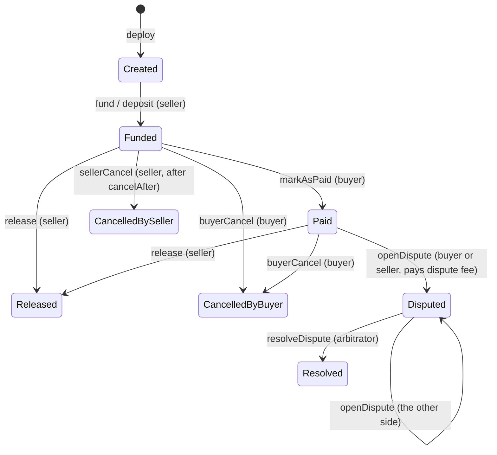

# Jamin escrow specification

This document describes what the two escrow contracts in `contracts/` accept and what they pay. It is written from
the sources at the commit it is part of; where it and the sources disagree, the sources win. The port from
OpenPeerEscrow and the reason for each change are in `docs/PORTING.md`.

## Contracts

| Contract | Escrows | Source |
|---|---|---|
| `JaminEscrow` | BCH in the satoshi container | `contracts/JaminEscrow.scash` |
| `JaminTokenEscrow` | one fungible CashToken category (for example PUSD) in the token container | `contracts/JaminTokenEscrow.scash` |

Both inherit `EscrowBase` (`contracts/EscrowBase.scash`): status, terms, events, errors, role modifiers and the shared
state transitions. Both use the fee rule of the `FeeMath` library (`contracts/FeeMath.scash`). Each escrow is one
native stateful contract instance with its own state category; there is no shared storage between escrows.

## Parameters and constructor

Contract parameters, fixed in the contract's address:

| Name | Type | Meaning |
|---|---|---|
| `seller` | `pubkey` | locks the coins, releases them, may cancel after the waiting time |
| `buyer` | `pubkey` | pays fiat off chain, marks the trade paid, may cancel |
| `arbitrator` | `pubkey` | decides an open dispute, nothing else |
| `feeRecipient` | `bytes20` | public key hash that receives the trade fee and a losing side's dispute fee |
| `token` | `bytes32` | token escrow only: the escrowed token category |

Constructor arguments, checked once at deployment:

| Name | Rule | Error |
|---|---|---|
| `amount` | `> 0` (satoshis, or token base units) | `InvalidAmount` |
| `feeBps` | trade fee in basis points of `amount`, rounded down, raised to the floor | (none) |
| `disputeFee` | `> 0` satoshis; paid in BCH by each side that opens a dispute, in both contracts | `InvalidDisputeFee` |
| `cancelAfter` | `>= 500,000,000`, a Unix timestamp; block heights are refused | `InvalidCancelTime` |

The trade fee is `amount * feeBps / 10000`, raised to 546 sats (P2PKH dust limit) in the BCH escrow and to one base
unit in the token escrow. The constructor stores `Terms(amount, fee, disputeFee, cancelAfter)` and emits
`EscrowCreated(amount, fee, cancelAfter)`.

The deployment transaction also opens the single satoshi container with a small reserve
(`escrow.containerReserveSats` in `config/jamin.json`, 1,000 sats). The reserve stays in the contract when the escrow
closes (see "Known limits" in the README).

## State

| Variable | Type | Initial |
|---|---|---|
| `status` | `Status` | `Created` |
| `terms` | `Terms { amount, fee, disputeFee, sellerCanCancelAfter }` | set by the constructor |
| `buyerPaidDispute` | `bool` | `false` |
| `sellerPaidDispute` | `bool` | `false` |

`Status` is one of `Created`, `Funded`, `Paid`, `Disputed`, `Released`, `CancelledByBuyer`, `CancelledBySeller`,
`Resolved`. The last four are final: no function accepts them, so a closed escrow cannot be spent again.

## Functions

Every function takes the caller's signature `s` and checks it with `checkSig` against the stored key of the role.
Token escrow functions marked "(token)" also take the category and require it to equal `token` (`WrongToken`).

| Function | Signed by | Requires | Value in | Paid out | New status | Event |
|---|---|---|---|---|---|---|
| `fund(s)` (BCH) | seller | status `Created`; `msg.value == amount + fee` | amount + fee sats | none | `Funded` | `Funded` |
| `deposit(s, c)` (token) | seller | token container empty; the call's output container holds exactly amount + fee + 1 unit; status `Created` | amount + fee + 1 units | none | `Funded` | `Funded` |
| `markAsPaid(s[, c])` | buyer | status `Funded` | none | none | `Paid` | `SellerCancelDisabled` |
| `release(s[, c])` | seller | status `Funded` or `Paid` | none | fee to fee recipient, amount to buyer | `Released` | `Released` |
| `buyerCancel(s[, c])` | buyer | status `Funded` or `Paid` | none | amount + fee to seller | `CancelledByBuyer` | `CancelledByBuyer` |
| `sellerCancel(s[, c])` | seller | status `Funded`; `tx.time >= cancelAfter` | none | amount + fee to seller | `CancelledBySeller` | `CancelledBySeller` |
| `openDispute(s, byBuyer)` | buyer if `byBuyer`, else seller | status `Paid` or `Disputed`; `msg.value == disputeFee`; that side has not paid yet | dispute fee sats | none | `Disputed` | `DisputeOpened` |
| `resolveDispute(s[, c], buyerWins)` | arbitrator | status `Disputed` | none | see below | `Resolved` | `DisputeResolved` |

Errors, in the order the checks run where it matters:

| Situation | Error |
|---|---|
| wrong signer for the role | `NotSeller`, `NotBuyer`, `NotArbitrator` |
| token category other than `token` | `WrongToken` |
| second deposit | `AlreadyFunded` |
| deposit of the wrong size | `WrongDeposit` |
| mark as paid before the deposit | `NotFunded` |
| mark as paid twice, or seller cancel after mark as paid | `AlreadyMarkedPaid` |
| release or buyer cancel when not `Funded`/`Paid` (for example during a dispute) | `NotOpen` |
| seller cancel before `cancelAfter` | `TooEarly` (reported by the SDK as a locktime failure, see F7) |
| dispute before mark as paid | `NotPaid` |
| dispute fee of the wrong size | `WrongDisputeFee` |
| the same side paying a dispute fee twice | `AlreadyPaidDispute` |
| resolution without an open dispute | `NoDispute` |

## Dispute payouts

`resolveDispute` pays every coin held for the trade, except the reserve. "Paid" below means that side paid the
dispute fee with `openDispute`.

| Outcome | Winner receives | Fee recipient receives |
|---|---|---|
| buyer wins | amount, plus the buyer's dispute fee if paid | trade fee, plus the seller's dispute fee if paid |
| seller wins | amount + trade fee, plus the seller's dispute fee if paid | the buyer's dispute fee if paid |

In the token escrow, amount and trade fee are tokens and dispute fees are BCH; the same table applies to each.
An output of zero is not created.

## Payouts are covenant outputs

Each `this.transfer` and `this.tokens[c].transfer` fixes the recipient's locking bytecode (`P2PKH` of the stored key
or hash) and the exact amount. A transaction that pays a different address, a different amount, or adds a payment
out of the escrow fails the contract (see `test/JaminEscrow.covenant.test.ts` and
`test/JaminTokenEscrow.covenant.test.ts`). Anyone may pay the network fee and add their own inputs and change.

## Off-chain duties

The contract cannot see fiat. Before paying, the buyer checks that the contract's parameters name the agreed seller,
buyer key, arbitrator and fee recipient, that `terms` match the trade and `cancelAfter` leaves enough time, and that
`status` is `Funded`. `docs/THREAT_MODEL.md` lists what each role can and cannot do.
